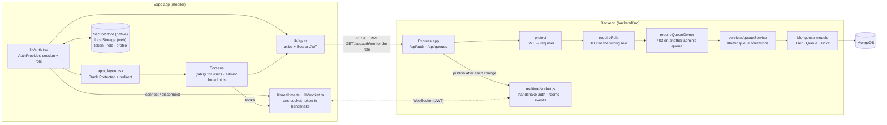
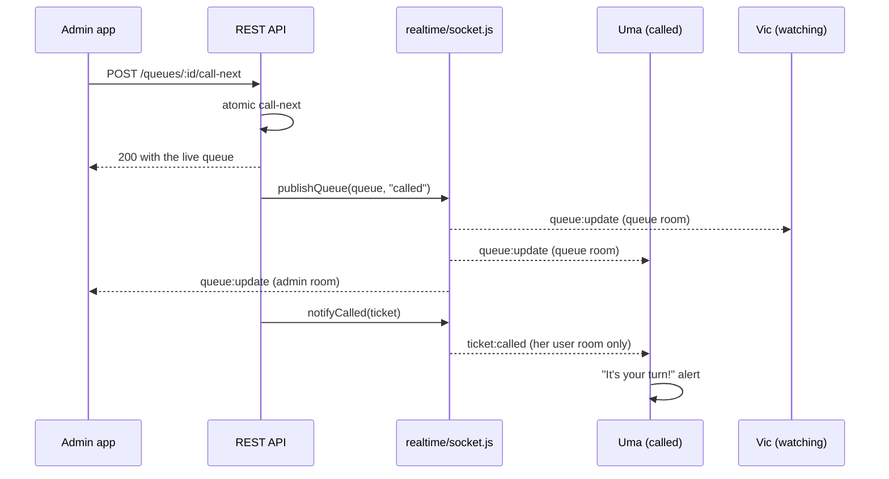

# QueueEase

[](https://github.com/mishalsheza/QueueEase/actions/workflows/ci.yml)

QueueEase is a virtual queue for clinics, banks, colleges and service desks.
People join from their phone and get a token and their place in line, and the
app tells them when it's their turn. Staff run their counters from an admin
dashboard. Everything updates live, with no refreshing.

**Live API:** [queueease-api-51p2.onrender.com/api/health](https://queueease-api-51p2.onrender.com/api/health).
It runs on Render's free plan, so after 15 minutes without traffic it sleeps,
and the first request can take about a minute to wake it. Only the API is
hosted. The app runs through Expo (see [Running locally](#running-locally)).

## Contents

- [Features](#features)
- [Architecture](#architecture)
- [Design decisions](#design-decisions)
- [Results](#results)
- [Tech stack](#tech-stack)
- [Running locally](#running-locally)
- [Tests and benchmarks](#tests-and-benchmarks)
- [Deployment](#deployment)
- [Known limitations](#known-limitations)

## Features

**For people in the queue**

- Sign up and log in. Anyone who signs up is a regular user; admin accounts
  are created with a script.
- See the open queues with how many people are waiting, and join with one tap.
- See your token, your position, an estimated wait and who is being served
  now, all updating live.
- Get an **"It's your turn!"** alert the moment staff call you, on whichever
  tab is open.
- Leave a queue, and see your history: served, cancelled or no-show.

**For staff (admins)**

- Create queues with a type, a section and a grace period.
- **Call next** and **serve**. Calling the next person automatically marks the
  previous one as served.
- **Mark no-show** when the person called doesn't come. Their ticket leaves
  the queue and the counter is free. Once someone has been called for longer
  than the queue's grace period, the dashboard marks them "overdue".
- **Pause** a queue (no new joins, the waiting list is kept) and **resume** it.
- **Close** a queue: anyone still waiting is removed, and its history stays in
  the reports.
- A dashboard with waiting counts, now serving and next token per counter, a
  per-section breakdown and recently completed tickets. A users screen lists
  everyone in your queues, with filters.
- Admins only see and manage their own queues.

## Architecture

An Expo (React Native) app talks to a Node/Express API over REST and receives
live updates over Socket.IO. Data is in MongoDB. More detail, with
before/after notes for each change, is in
[docs/architecture.md](docs/architecture.md).



**What happens when staff press "Call next":**



## Design decisions

**Ticket-first, atomic queue model.** The first version kept each queue's
waiting list twice: as an array inside the queue document and as ticket
documents. Every action loaded the queue, edited the array and saved it back.
Under concurrent requests that produced duplicate tokens and double joins.
Now **tickets are the only source of truth**: the waiting list, "now serving"
and positions are queries on tickets. Each change is one atomic MongoDB
update. A join, for example, reserves its number with a single `$inc` on
the queue's counter, and only matches if the queue is open.
([architecture §3](docs/architecture.md#3-queue-model-and-concurrency-current))

**Unique indexes enforce the rules.** Instead of checking and then writing,
which races, the database refuses the bad state:

- a unique `(queue, seq)` index: no two tickets share a token
- a partial unique index on `(queue, user)` for active tickets: a double tap
  can't give someone two places. The losing request returns the existing
  ticket, so joining is idempotent.
- a partial unique index on `queue` for tickets at the counter: never two
  people at one counter
- serve and no-show each match only the ticket at the counter, so if both
  happen at once, exactly one wins and the other gets 409

**Role and ownership checks on the server.** The role comes from the server
(`GET /api/auth/me`), not from the device. Every route goes through `protect`
(JWT), then `requireRole` (403 for the wrong role), then `requireQueueOwner`
(403 on another admin's queue). The app's route guards only hide screens.
Every route validates its input with zod. Login errors are generic, so they
don't reveal which emails have accounts. Login and sign-up are rate limited
per client IP, and `TRUST_PROXY` makes that IP correct behind Render's two
proxies. ([architecture §2](docs/architecture.md#2-role-based-workflow-current))

**Authenticated sockets with per-queue rooms.**

- **Login required:** a socket must present a valid JWT in the handshake, or
  it is refused.
- **Rooms set by the server:** clients can't join a room by name. The server
  joins them after checking they may see that queue.
- **Small updates:** a `queue:update` carries a summary with no user ids, and
  the app re-reads details over REST.
- **Private "called" alert:** `ticket:called` goes only to the person called,
  on all of their devices.

([architecture §4](docs/architecture.md#4-live-updates-current))

## Results

All measured with scripts in [`backend/bench/`](backend/bench). Full tables and
method are in [docs/architecture.md](docs/architecture.md).

**Concurrency before and after the ticket-first model**
([§3.7](docs/architecture.md#37-concurrency-numbers-before--after)). The same
script ran both versions: 1,625 concurrent requests (bursts of joins, double
taps, join/leave storms, call-next racing joins).

| Per 1,625 requests | Before (3 runs) | After (3 runs) |
|---|---|---|
| Duplicate tokens | 883–893 | **0** |
| Double joins | 851–862 | **0** |
| Waiting list out of sync with tickets | 125–135 | **0** |
| Requests rejected with 409 (user action lost) | 149–153 | **0** |

The original code, before error handling was added, also had 141 unhandled
rejections in its one run. Each would have crashed the server.

**Indexes** ([§5](docs/architecture.md#5-indexes-current)). `explain()` was run
on every main query against 100,000 tickets:

| | Before | After |
|---|---|---|
| Collection scans | 3 | **0** |
| In-memory sorts | 6 | **0** |
| Completed report: documents examined to return 20 | 2,883 | **20** |
| "My active tickets": documents examined to return 1 | 22 | **1** |

A test fails the build if any main query goes back to a collection scan or an
in-memory sort.

**Load test** ([§6](docs/architecture.md#6-load-test-current)). One server
process on an Apple M3 laptop (8 cores), with MongoDB on the same machine.
Each user has an authenticated WebSocket. Users join and leave about every
5 s while admins call the next person, in 5 queues:

| Concurrent users | Join / call-next p95 | Live update reaches every watcher (p95) | Delivered | Errors |
|---|---|---|---|---|
| 100–500 | ≤ 29 / ≤ 35 ms | ≤ 34 ms | 100% | 0 |
| **1,000** | **22–30 / 19–44 ms** | **18–44 ms** | **100% of 20,000** | **0** |
| 1,500 | 1.2 s / 3.8 s | 3.8 s | 100% | 0 |
| 2,000 | 6.3 s / up to 9.8 s | up to 9.8 s | 100% | ~2,000 timeouts |

- **Comfortable up to ~1,000 users:** about 235 requests/s, every live update
  delivered, no errors.
- **1,500:** no errors, but p95 latency rises to 1–4 s.
- **2,000:** requests and new connections start timing out.
- **Simultaneous bursts degrade first:** 1,000 users joining in the same
  instant take 2.6 s at p95, about half of it from broadcasting each join to
  everyone watching the queue.
- **Integrity:** there were zero duplicate tokens or positions in every run,
  including the overloaded ones.
- **Scope:** these numbers describe one process on a laptop, not the free
  Render instance.

## Tech stack

| | |
|---|---|
| **Backend** | Node.js 22, Express 4, MongoDB with Mongoose 9, Socket.IO 4, JWT (jsonwebtoken), bcryptjs, zod, helmet, express-rate-limit |
| **App** | Expo SDK 58, React Native 0.88, React 19, Expo Router, TypeScript 6, axios, socket.io-client, expo-secure-store |
| **Testing** | Jest 30, Supertest and mongodb-memory-server (backend); Node's test runner (app) |
| **Infrastructure** | GitHub Actions CI, Docker and Docker Compose, Render (API), MongoDB Atlas |

## Running locally

You need Node.js 22.13+, 24 or 26 (Expo SDK 58 doesn't support 23 or 25) and
MongoDB (local, or Docker below). For the
app on a phone, install Expo Go.

**Backend**

```bash
cd backend
cp .env.example .env      # set JWT_SECRET; the file explains each variable
npm install
npm run dev               # http://localhost:5001, health at /api/health

# an admin account (sign-up only creates regular users)
ADMIN_PASSWORD='choose-one' node scripts/create_admin.js --name "Your Name" --email you@example.com
# or reset a local database to demo data (admin@example.com / john@example.com, password123)
node scripts/seed_db.js --yes
```

**App**

```bash
cd mobile
cp .env.example .env      # optional in development, see below
npm install
npx expo start            # scan the QR code with Expo Go, or press w for web
```

In development the app finds the backend by itself: `localhost:5001` on web,
and your computer's address on a phone. Set `EXPO_PUBLIC_API_URL` (no `/api`)
to use another backend, such as the deployed one.

**Backend with Docker**

Runs the API and its own MongoDB, with no `.env` needed:

```bash
docker compose up --build   # API on http://localhost:5001
docker compose down         # add -v to also delete the data
```

A `JWT_SECRET` is generated on first start and kept in a volume. See
[docker-compose.yml](docker-compose.yml) for the optional settings and for
creating an admin.

**Environment variables**

- [backend/.env.example](backend/.env.example) documents every variable the
  server checks at startup: `MONGO_URI`, `JWT_SECRET` (at least 32
  characters) and `CORS_ORIGINS` are required, the rest are optional. The
  server refuses to start, listing every problem, if one is missing or
  invalid.
- [mobile/.env.example](mobile/.env.example) documents `EXPO_PUBLIC_API_URL`.

## Tests and benchmarks

```bash
cd backend && npm test        # 324 tests, in-memory MongoDB, no .env needed
cd mobile && npx tsc --noEmit && npm run lint && npm test
```

CI runs both on every push and pull request, plus a Docker Compose smoke
test. The benchmarks start their own throwaway database and never touch your
`.env` one:

```bash
cd backend
npm run bench:concurrency     # duplicate tokens / double joins under concurrency
npm run bench:explain         # query plans for the main queries
npm run bench:load            # concurrent socket users, 100 to 1,000 (~3 min)
```

## Deployment

The API deploys to Render from [render.yaml](render.yaml), with MongoDB Atlas
for data. Pushes to `main` deploy only after CI passes.
[docs/deploy-render.md](docs/deploy-render.md) covers:

- step-by-step setup
- every environment variable
- Atlas network access
- checking `TRUST_PROXY`
- pointing the app at the deployed URL

## Known limitations

- **Scale:** one Node process handles about 1,000 concurrently active users
  comfortably (see the load test). Going further needs several processes with
  the Socket.IO Redis adapter. Rate-limit counters are in memory, so they
  reset on every restart and aren't shared between processes.
- **Free hosting:** the deployed API sleeps after 15 idle minutes. The first
  request after that can take about a minute, longer than the app's 30 s
  request timeout, so it may fail once and work on retry.
- **No push notifications:** "It's your turn!" reaches an open app only. The
  Alerts tab is a placeholder.
- **Socket sessions:** a socket is authenticated when it connects. If the token
  expires or the account is deleted while it's connected, it stays connected
  until it disconnects. Every REST call is still checked.
- **No automatic no-show:** the grace period only marks someone "overdue". Staff
  mark no-shows by hand. [Architecture §3.6](docs/architecture.md#36-ticket-states-and-no-shows)
  describes what an automatic one would take.
- **Rough estimates:** the estimated wait is a fixed 5 minutes per person
  ahead.
- **Dashboard figures that don't match their labels:**
  - "Served Today" is never reset daily, and it drops a queue's count once
    that queue is closed.
  - "Avg. Process" is a fixed 15 minutes, not calculated.
- **Unfinished UI:** "Forgot Password?" and the "Call user" button on the
  admin users screen do nothing yet.
- **Closed queues** can't be reopened (by design: their history is kept).
