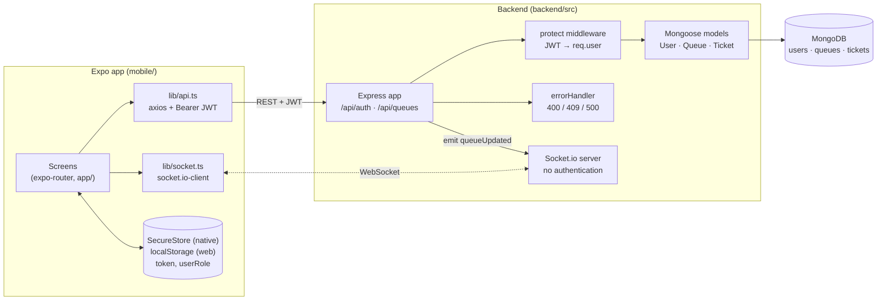
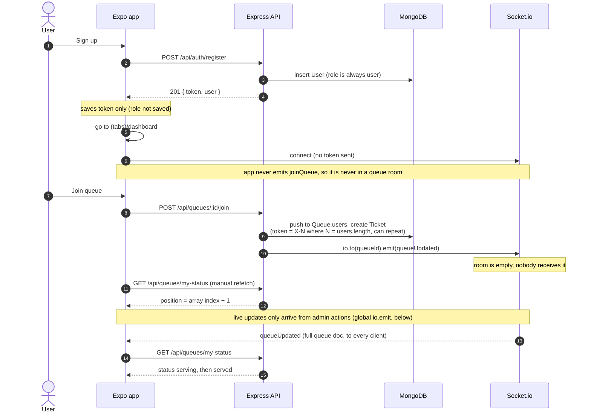
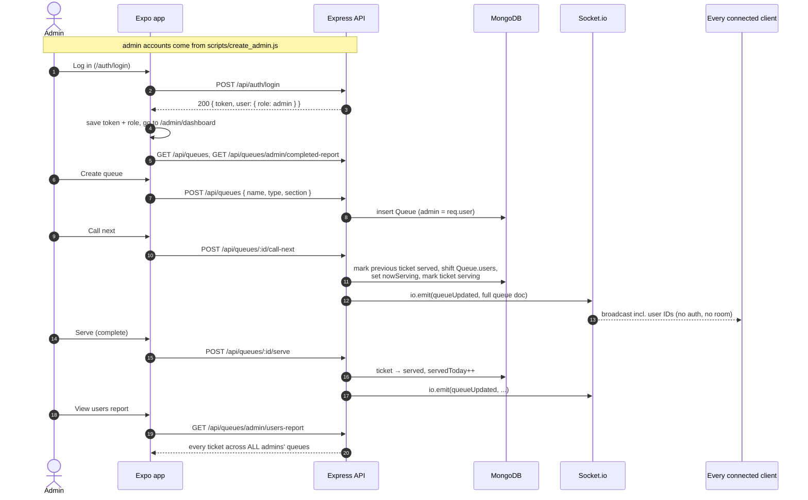
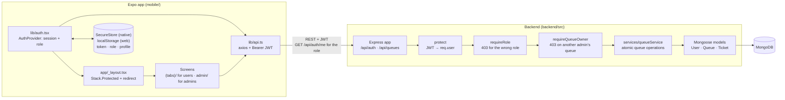
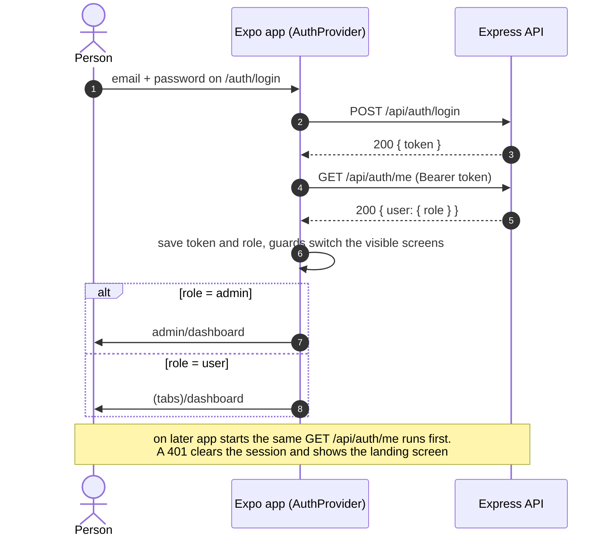
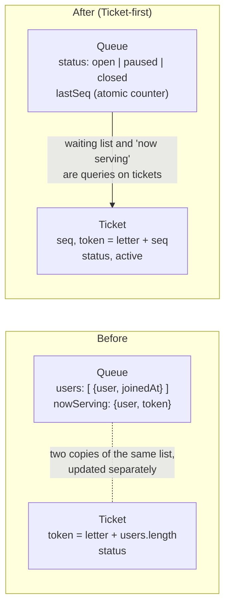
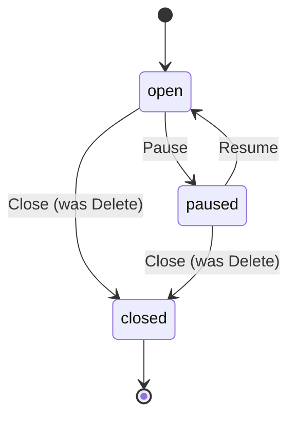
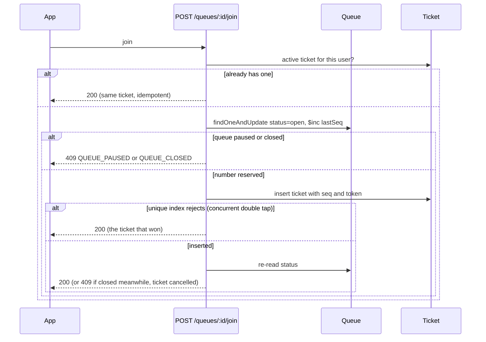

# QueueEase architecture

QueueEase is a queue management app: an Expo (React Native) client talks to a
Node/Express API over REST, receives live updates over Socket.io, and stores
data in MongoDB.

This document has three parts:

1. **Before the role-based workflow change**: how the app behaved when it was
   audited, including the problems found. Kept for reference.
2. **Role-based workflow (current)**: how login, roles and navigation work now.
3. **Queue model and concurrency (current)**: the Ticket-first queue model,
   queue status (open / paused / closed), and before/after concurrency numbers.

---

## 1. Before the role-based workflow change

### 1.1 System (before)

### 1.2 Navigation (before)

Red nodes are dead, duplicate or mock screens.

### 1.3 User workflow (before)

### 1.4 Admin workflow (before)

### 1.5 Mismatches between backend and app (and their status)

| # | Where | What the backend does | What the app does |
|---|---|---|---|
| 1 | Startup ([_layout.tsx](../mobile/app/_layout.tsx)) | `/api/auth/me` returns the real user and role | Never asks the server; trusts the role saved on the device. Signup saves no role, so the app treats the account as a user. |
| 2 | Startup redirect | n/a | Any saved token redirects to the user tabs from every screen outside `(tabs)`/`admin`, including `/auth/login`. An admin can't reach the login form without logging out first. |
| 3 | Route guards | Admin endpoints return 403 for users | No client guard: a user can open `/admin/dashboard` by URL (it renders, then API calls fail). Admins can open the user tabs and join queues. |
| 4 | Admin login | One `/api/auth/login` for all roles | Two entry points (`?type=user` / `?type=admin`) to the same screen, plus a separate **mock** `/admin/login` with hardcoded credentials, linked from the user dashboard's "Admin" button. |
| 5 | Admins joining queues | `POST /:id/join` accepts admins | User-only join flow is reachable by admins. |
| 6 | Errors on web | Returns `{ message }` | `Alert.alert` is a no-op in React Native Web, so every error/success pop-up is silently dropped in the browser. |
| 7 | Live updates | `join`/`leave` emit to room `queueId` | App never emits `joinQueue`, so room events are never received; only global `io.emit` from admin actions arrives. |
| 8 | Position | `GET /:id/position` exists | No screen uses it; `my-status` is used instead. |
| 9 | Pause / resume | No queue `status` field | Admin dashboard toggles it locally only. |
| 10 | Next token | Server assigns tokens | Admin dashboard computes "next token" on the client; it doesn't match. |
| 11 | Alerts tab | No notifications API | Placeholder screen. |
| 12 | `test-api.tsx` | No `/api/test` route | Calls a route that doesn't exist. |
| 13 | Route collisions | n/a | `(admin)/dashboard` and `(admin)/profile` resolve to `/dashboard` and `/profile`, colliding with `(tabs)`. |

**Status:** #1–#6, #12 and #13 are fixed by the role-based workflow (section 2).
#9 and #10 are fixed by the queue model change (section 3): pause/resume is
stored on the server and the next token comes from the server.
#7 (socket rooms) is planned as part of socket authentication; #8 and #11 are
still open.

---

## 2. Role-based workflow (current)

### 2.1 System

### 2.2 Principles

- **One login screen for everyone.** The server decides the role.
- **Role comes from the server.** After login and on every app start, the app calls
  `GET /api/auth/me`. The role saved on the device is only a fallback when the
  server can't be reached.
- **Admins only manage their own queues.** Call next, serve, pause/resume and
  close check that the queue belongs to the signed-in admin (403 otherwise);
  the queue list and reports only include that admin's queues.
- **Guards on both sides.** The client uses `Stack.Protected` to show each role only
  its own screens. The backend stays the source of truth and returns 403 for
  wrong-role requests, including admins trying to join or leave queues.
- **Role is saved with the token**, so a restart lands on the right home screen.

### 2.3 Navigation

The guards in [app/_layout.tsx](../mobile/app/_layout.tsx) work in two layers:

1. **`Stack.Protected`** registers only the current state's screens, so another
   role's screen can never render, even from a typed URL or deep link.
2. **An explicit redirect**: whenever the session or URL changes, a path that
   isn't allowed for the current state is replaced with that state's home
   screen (`/`, `/dashboard` or `/admin/dashboard`). Without it, expo-router
   falls back to the first remaining group without choosing a tab, and the URL
   could say `/alerts` while the Dashboard tab was shown.

### 2.4 Login

### 2.5 Screens removed

| Path | Why |
|---|---|
| `app/(admin)/dashboard.tsx`, `app/(admin)/profile.tsx` | Sample/mock data; collide with `(tabs)` routes |
| `app/admin/login.tsx` | Mock login with hardcoded credentials |
| `app/admin/profile.tsx` | Static placeholder, nothing links to it; admin dashboard already has logout |
| `app/test-api.tsx` | Calls a non-existent route |
| `app/modal.tsx` | Unused Expo template screen |
| `pages/Dashboard.js`, `api/api.js`, `socket.js` | Old web-React code; not part of the Expo app |

---

## 3. Queue model and concurrency (current)

### 3.1 What changed

Before, a queue stored its waiting list twice: as a `users` array inside the
Queue document **and** as Ticket documents. Every action loaded the queue,
changed the array in memory and saved it back, and the token was computed as
`first letter + waiting-list length`. Under concurrent requests this produced
duplicate tokens, users joined twice, and a list that disagreed with the
tickets.

Now **tickets are the single source of truth**. The Queue document only holds
settings, a lifecycle `status` and a ticket counter. Every change is one atomic
MongoDB update, or an insert guarded by a unique index.

### 3.2 How each guarantee is enforced

| Guarantee | Mechanism |
|---|---|
| Every token in a queue is unique | `lastSeq` is reserved with one atomic `$inc` on join. Unique index on `(queue, seq)`. |
| A user can't hold two places in one queue (double taps) | Unique partial index on `(queue, user)` where `active: true`. The losing request returns the existing ticket (join stays idempotent). |
| Only one person at the counter | Unique partial index on `queue` where `status: "serving"`. A concurrent second call-next gets 409 and nobody is skipped. |
| Paused/closed queues reject joins | The `$inc` that reserves a number only matches `status: "open"`. |
| A join racing a close leaves nothing behind | After inserting, join re-reads the status and cancels its own ticket if the queue was closed meanwhile. |
| List and tickets can't disagree | There is no list any more. `users`, `nowServing`, `waitingCount` and `nextToken` in API responses are computed from tickets. |

### 3.3 Queue status

| | open | paused | closed |
|---|---|---|---|
| New joins | yes | 409 `QUEUE_PAUSED` | 409 `QUEUE_CLOSED` |
| Waiting list | kept | kept | waiting tickets cancelled |
| Leave | yes | yes | n/a |
| Call next / serve | yes | yes (work through who is waiting) | call next 409 |
| Listed for users / admin | yes | yes, with its status | no |
| Tickets in admin reports | yes | yes | yes (history is kept) |

Closing also completes the ticket of the person at the counter (`served`),
the same rule call-next uses. A closed queue can't be reopened.

### 3.4 Join (sequence)

### 3.5 API changes

| Endpoint | Change |
|---|---|
| `PATCH /api/queues/:id/status` | **New.** Body `{ "status": "paused" }` or `{ "status": "open" }`. Owner only. |
| `POST /api/queues/:id/close` | **New.** Closes the queue. Owner only. Returns `{ message, cancelled, servedCurrent }`. |
| `DELETE /api/queues/:id` | Now an alias for close. The queue document and its tickets are kept. |
| `POST /api/queues/:id/join` | 409 when the queue is paused or closed. |
| `GET /api/queues` and queue responses | Add `status`, `waitingCount`, `nextToken`. `users` and `nowServing` keep their shape but are computed from tickets. Closed queues are left out. |
| `GET /api/queues/my-status` | Adds `queueStatus`. Positions come from ticket order. |
| Admin reports | Include tickets from closed queues. |

Existing databases are moved to the new model with
`node scripts/migrate_queue_model.js` (dry run) and `--apply`. The migration
never deletes data, numbers existing tickets in join order, and cleans up
leftovers of the old double-join bug.

### 3.6 Concurrency numbers (before / after)

Measured with [`backend/bench/concurrency.js`](../backend/bench/concurrency.js)
(`npm run bench:concurrency`). It runs the real Express app against a throwaway
in-memory MongoDB and fires real concurrent HTTP requests. It only uses
endpoints that exist in both versions, so the same script measured both.

Each run is 5 rounds of four scenarios (1,625 requests):

- **burst:** 50 users join one queue at the same moment
- **churn:** 10 waiting, then 15 steps of call-next + join + leave fired together
- **taps:** 20 users each tap Join 5 times at once
- **storm:** 30 users each send join, leave, join, leave at once

| Metric (per 1,625 requests) | Original code (`fcfbb39`) | Before A4 (after error handling, A1) | After A4 |
|---|---|---|---|
| Duplicate tokens | 391 | 883–893 | **0** |
| Double joins (extra active tickets / list entries) | 222 | 851–862 | **0** |
| Waiting list out of sync with tickets | 114 | 125–135 | **0** |
| Unhandled rejections (each would crash the server) | 141 | 0 | **0** |
| Requests that never got a response | 141 | 0 | **0** |
| Requests rejected with 409 (user action lost, retry needed) | 0 | 149–153 | **0** |
| 5xx responses | 0 | 0 | **0** |

"Before A4" and "After A4" are ranges over 3 runs each; "After A4" was 0 in
every run. The original code was run once. It shows fewer duplicates only
because 141 of its requests crashed instead of completing: on a real server
the first unhandled rejection takes the whole process down.

The same guarantees are checked on every test run by
[`backend/tests/concurrency.test.js`](../backend/tests/concurrency.test.js).
