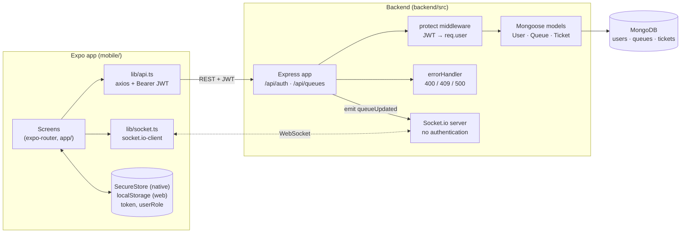
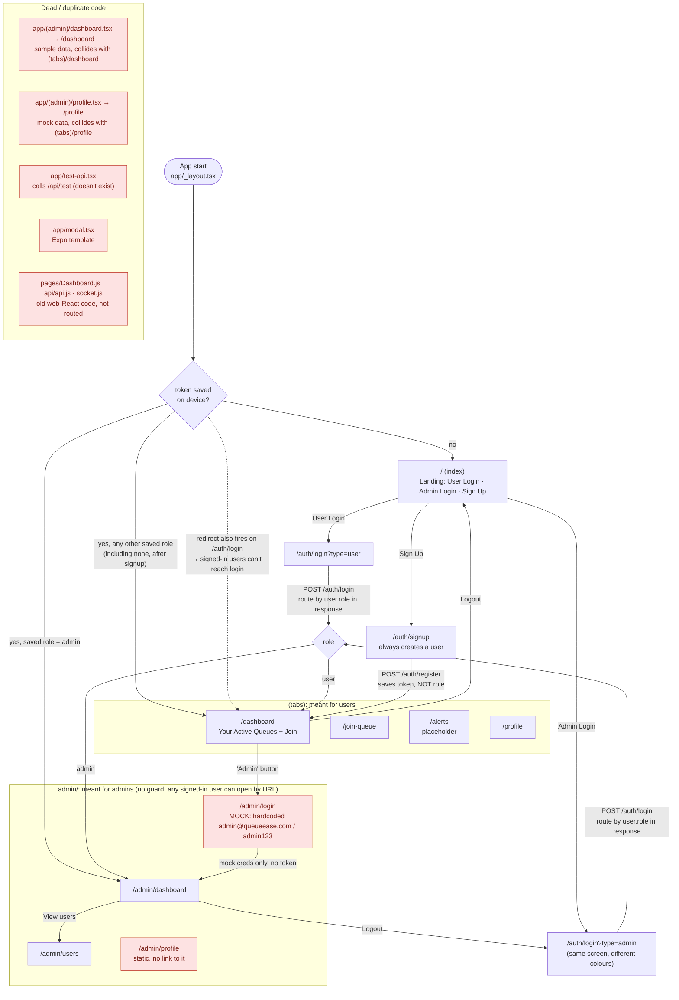
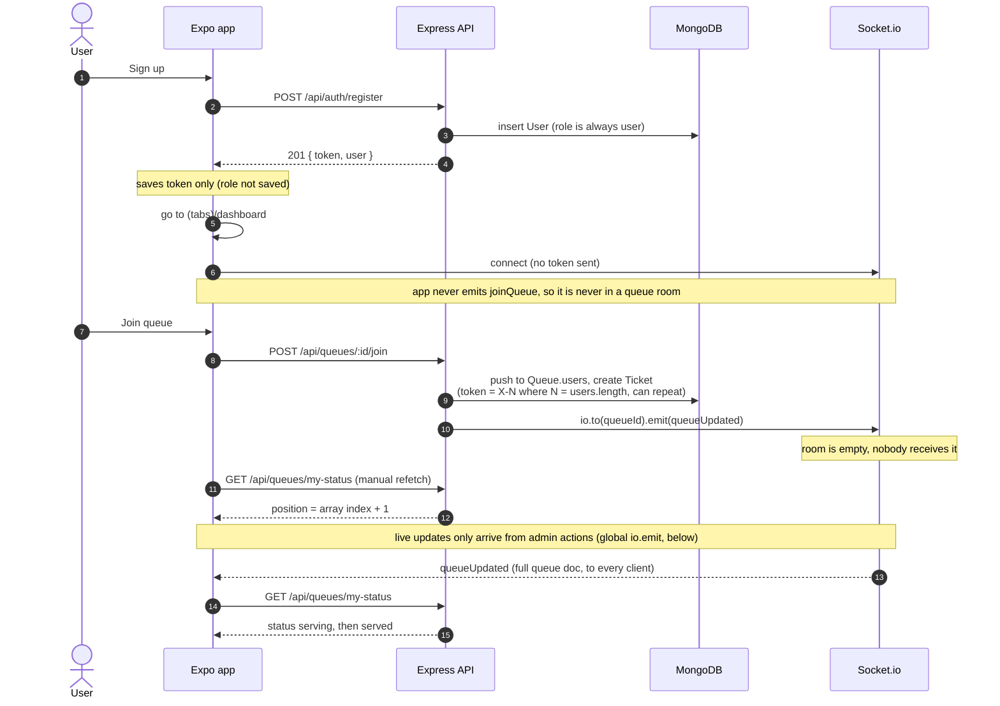
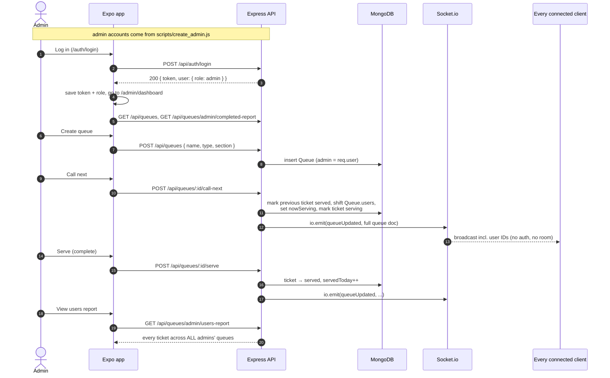
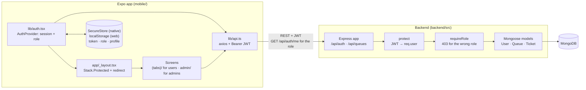
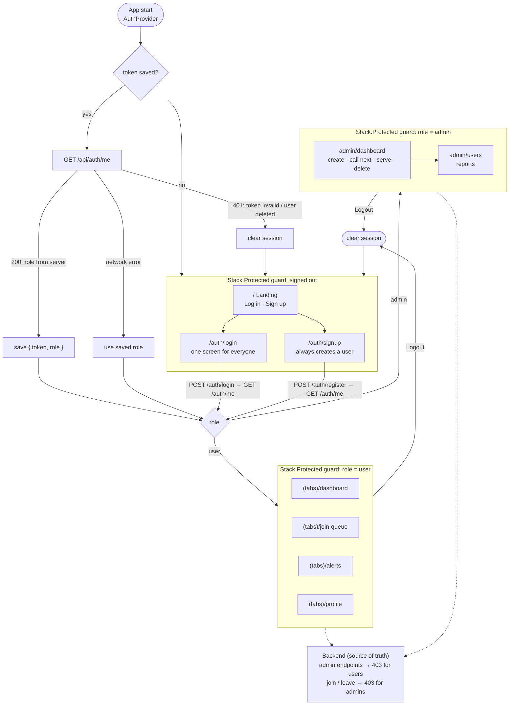
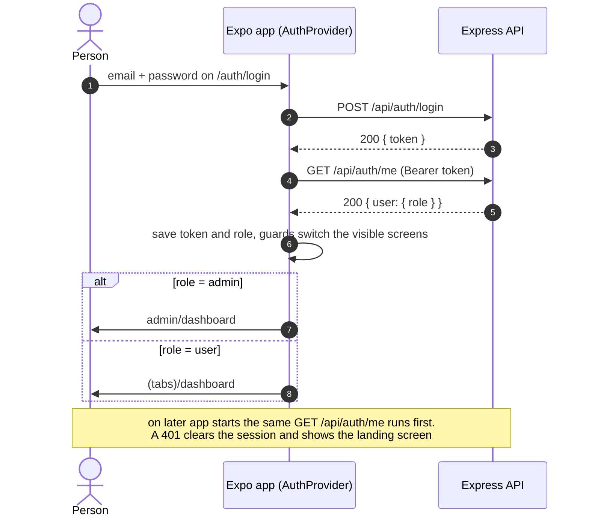

# QueueEase architecture

QueueEase is a queue management app: an Expo (React Native) client talks to a
Node/Express API over REST, receives live updates over Socket.io, and stores
data in MongoDB.

This document has two parts:

1. **Before the role-based workflow change**: how the app behaved when it was
   audited, including the problems found. Kept for reference.
2. **Role-based workflow (current)**: how login, roles and navigation work now.

---

## 1. Before the role-based workflow change

### 1.1 System (before)

### 1.2 Navigation (before)

Red nodes are dead, duplicate or mock screens.

### 1.3 User workflow (before)

### 1.4 Admin workflow (before)

### 1.5 Mismatches between backend and app (and their status)

| # | Where | What the backend does | What the app does |
|---|---|---|---|
| 1 | Startup ([_layout.tsx](../mobile/app/_layout.tsx)) | `/api/auth/me` returns the real user and role | Never asks the server; trusts the role saved on the device. Signup saves no role, so the app treats the account as a user. |
| 2 | Startup redirect | n/a | Any saved token redirects to the user tabs from every screen outside `(tabs)`/`admin`, including `/auth/login`. An admin can't reach the login form without logging out first. |
| 3 | Route guards | Admin endpoints return 403 for users | No client guard: a user can open `/admin/dashboard` by URL (it renders, then API calls fail). Admins can open the user tabs and join queues. |
| 4 | Admin login | One `/api/auth/login` for all roles | Two entry points (`?type=user` / `?type=admin`) to the same screen, plus a separate **mock** `/admin/login` with hardcoded credentials, linked from the user dashboard's "Admin" button. |
| 5 | Admins joining queues | `POST /:id/join` accepts admins | User-only join flow is reachable by admins. |
| 6 | Errors on web | Returns `{ message }` | `Alert.alert` is a no-op in React Native Web, so every error/success pop-up is silently dropped in the browser. |
| 7 | Live updates | `join`/`leave` emit to room `queueId` | App never emits `joinQueue`, so room events are never received; only global `io.emit` from admin actions arrives. |
| 8 | Position | `GET /:id/position` exists | No screen uses it; `my-status` is used instead. |
| 9 | Pause / resume | No queue `status` field | Admin dashboard toggles it locally only. |
| 10 | Next token | Server assigns tokens | Admin dashboard computes "next token" on the client; it doesn't match. |
| 11 | Alerts tab | No notifications API | Placeholder screen. |
| 12 | `test-api.tsx` | No `/api/test` route | Calls a route that doesn't exist. |
| 13 | Route collisions | n/a | `(admin)/dashboard` and `(admin)/profile` resolve to `/dashboard` and `/profile`, colliding with `(tabs)`. |

**Status:** #1–#6, #12 and #13 are fixed by the role-based workflow (section 2).
#7 (socket rooms) is planned as part of socket authentication; #8–#11 are
still open.

---

## 2. Role-based workflow (current)

### 2.1 System

### 2.2 Principles

- **One login screen for everyone.** The server decides the role.
- **Role comes from the server.** After login and on every app start, the app calls
  `GET /api/auth/me`. The role saved on the device is only a fallback when the
  server can't be reached.
- **Guards on both sides.** The client uses `Stack.Protected` to show each role only
  its own screens. The backend stays the source of truth and returns 403 for
  wrong-role requests, including admins trying to join or leave queues.
- **Role is saved with the token**, so a restart lands on the right home screen.

### 2.3 Navigation

The guards in [app/_layout.tsx](../mobile/app/_layout.tsx) work in two layers:

1. **`Stack.Protected`** registers only the current state's screens, so another
   role's screen can never render, even from a typed URL or deep link.
2. **An explicit redirect**: whenever the session or URL changes, a path that
   isn't allowed for the current state is replaced with that state's home
   screen (`/`, `/dashboard` or `/admin/dashboard`). Without it, expo-router
   falls back to the first remaining group without choosing a tab, and the URL
   could say `/alerts` while the Dashboard tab was shown.

### 2.4 Login

### 2.5 Screens removed

| Path | Why |
|---|---|
| `app/(admin)/dashboard.tsx`, `app/(admin)/profile.tsx` | Sample/mock data; collide with `(tabs)` routes |
| `app/admin/login.tsx` | Mock login with hardcoded credentials |
| `app/admin/profile.tsx` | Static placeholder, nothing links to it; admin dashboard already has logout |
| `app/test-api.tsx` | Calls a non-existent route |
| `app/modal.tsx` | Unused Expo template screen |
| `pages/Dashboard.js`, `api/api.js`, `socket.js` | Old web-React code; not part of the Expo app |
