# QueueEase architecture

QueueEase is a queue management app: an Expo (React Native) client talks to a
Node/Express API over REST, receives live updates over Socket.io, and stores
data in MongoDB.

This document has six parts:

1. **Before the role-based workflow change**: how the app behaved when it was
   audited, including the problems found. Kept for reference.
2. **Role-based workflow (current)**: how login, roles and navigation work now.
3. **Queue model and concurrency (current)**: the Ticket-first queue model,
   queue status (open / paused / closed), and before/after concurrency numbers.
4. **Live updates (current)**: authenticated sockets, rooms, small update
   messages and the "you're being called" notification.
5. **Indexes (current)**: query plans for the main queries, before and after.
6. **Load test (current)**: how many concurrent users one server process
   handles, and where it starts to degrade.

---

## 1. Before the role-based workflow change

### 1.1 System (before)

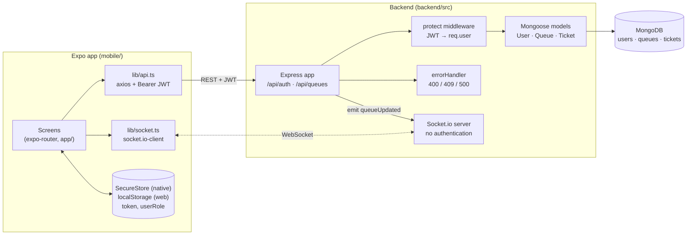

### 1.2 Navigation (before)

Red nodes are dead, duplicate or mock screens.

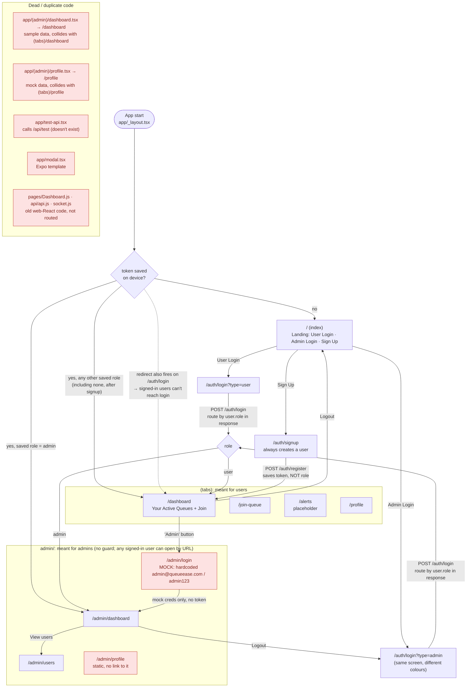

### 1.3 User workflow (before)

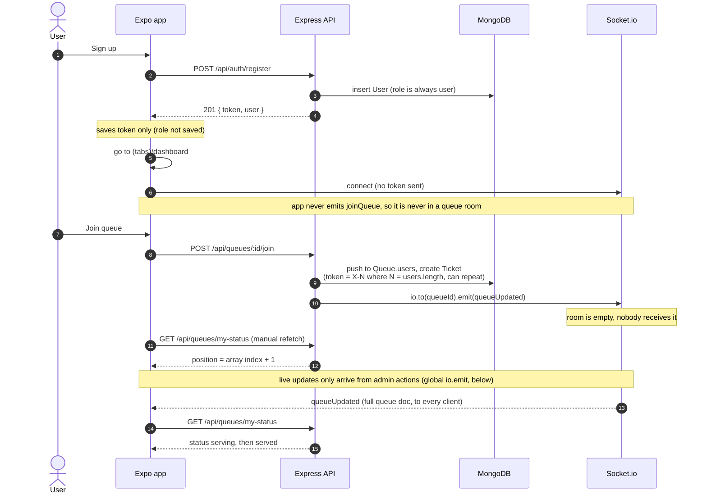

### 1.4 Admin workflow (before)

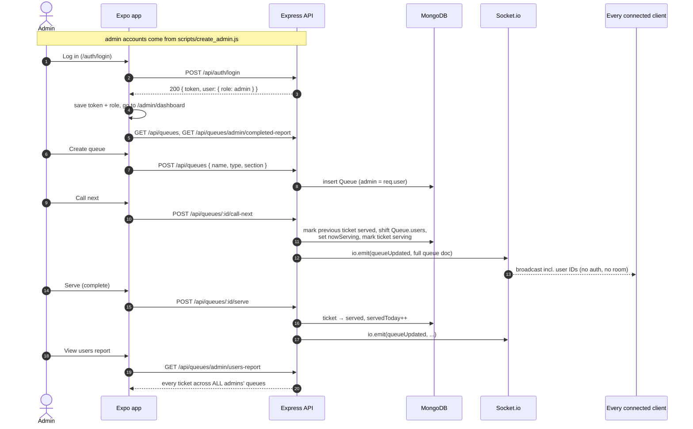

### 1.5 Mismatches between backend and app (and their status)

| # | Where | What the backend does | What the app does |
|---|---|---|---|
| 1 | Startup ([_layout.tsx](../mobile/app/_layout.tsx)) | `/api/auth/me` returns the real user and role | Never asks the server; trusts the role saved on the device. Signup saves no role, so the app treats the account as a user. |
| 2 | Startup redirect | n/a | Any saved token redirects to the user tabs from every screen outside `(tabs)`/`admin`, including `/auth/login`. An admin can't reach the login form without logging out first. |
| 3 | Route guards | Admin endpoints return 403 for users | No client guard: a user can open `/admin/dashboard` by URL (it renders, then API calls fail). Admins can open the user tabs and join queues. |
| 4 | Admin login | One `/api/auth/login` for all roles | Two entry points (`?type=user` / `?type=admin`) to the same screen, plus a separate **mock** `/admin/login` with hardcoded credentials, linked from the user dashboard's "Admin" button. |
| 5 | Admins joining queues | `POST /:id/join` accepts admins | User-only join flow is reachable by admins. |
| 6 | Errors on web | Returns `{ message }` | `Alert.alert` is a no-op in React Native Web, so every error/success pop-up is silently dropped in the browser. |
| 7 | Live updates | `join`/`leave` emit to room `queueId` | App never emits `joinQueue`, so room events are never received; only global `io.emit` from admin actions arrives. |
| 8 | Position | `GET /:id/position` exists | No screen uses it; `my-status` is used instead. |
| 9 | Pause / resume | No queue `status` field | Admin dashboard toggles it locally only. |
| 10 | Next token | Server assigns tokens | Admin dashboard computes "next token" on the client; it doesn't match. |
| 11 | Alerts tab | No notifications API | Placeholder screen. |
| 12 | `test-api.tsx` | No `/api/test` route | Calls a route that doesn't exist. |
| 13 | Route collisions | n/a | `(admin)/dashboard` and `(admin)/profile` resolve to `/dashboard` and `/profile`, colliding with `(tabs)`. |

**Status:** #1–#6, #12 and #13 are fixed by the role-based workflow (section 2).
#9 and #10 are fixed by the queue model change (section 3): pause/resume is
stored on the server and the next token comes from the server.
#7 is fixed by the live-updates change (section 4): the server puts each
socket in the rooms it is entitled to, and the app subscribes to the queues it
shows. #8 and #11 are still open.

---

## 2. Role-based workflow (current)

### 2.1 System

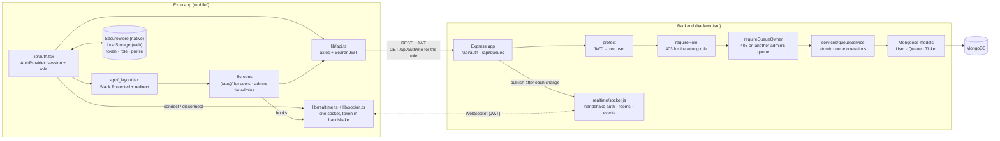

### 2.2 Principles

- **One login screen for everyone.** The server decides the role.
- **Role comes from the server.** After login and on every app start, the app calls
  `GET /api/auth/me`. The role saved on the device is only a fallback when the
  server can't be reached.
- **Admins only manage their own queues.** Call next, serve, pause/resume and
  close check that the queue belongs to the signed-in admin (403 otherwise);
  the queue list and reports only include that admin's queues.
- **Guards on both sides.** The client uses `Stack.Protected` to show each role only
  its own screens. The backend stays the source of truth and returns 403 for
  wrong-role requests, including admins trying to join or leave queues.
- **Role is saved with the token**, so a restart lands on the right home screen.

### 2.3 Navigation

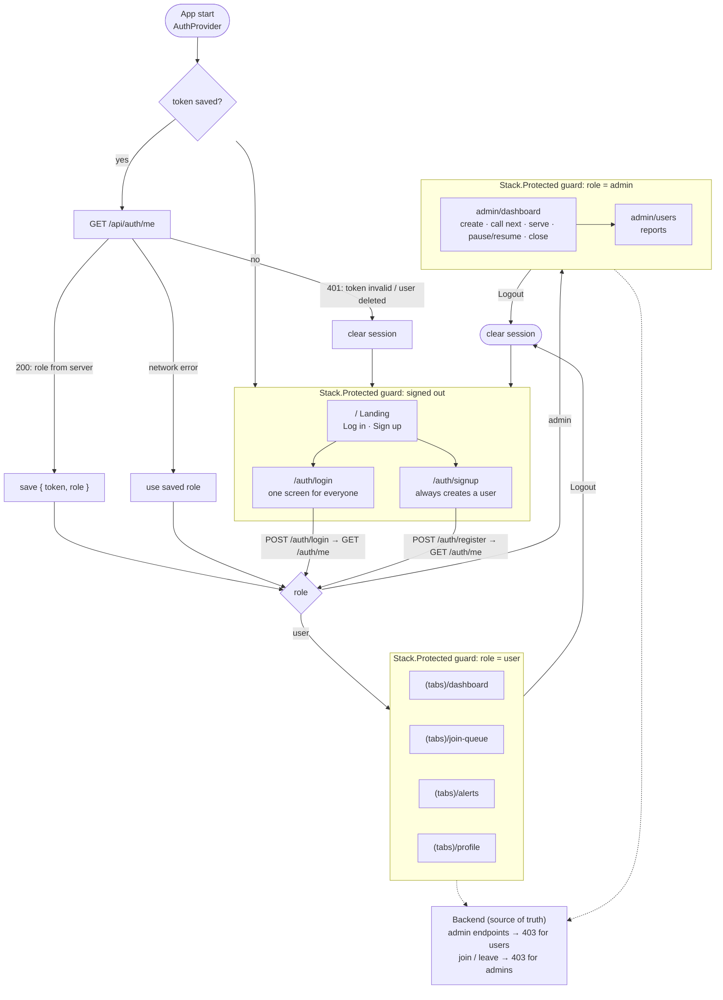

The guards in [app/_layout.tsx](../mobile/app/_layout.tsx) work in two layers:

1. **`Stack.Protected`** registers only the current state's screens, so another
   role's screen can never render, even from a typed URL or deep link.
2. **An explicit redirect**: whenever the session or URL changes, a path that
   isn't allowed for the current state is replaced with that state's home
   screen (`/`, `/dashboard` or `/admin/dashboard`). Without it, expo-router
   falls back to the first remaining group without choosing a tab, and the URL
   could say `/alerts` while the Dashboard tab was shown.

### 2.4 Login

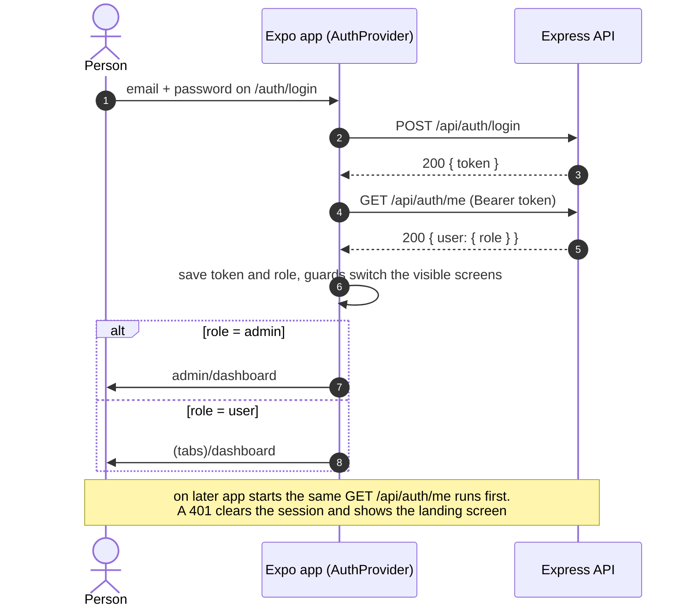

### 2.5 Screens removed

| Path | Why |
|---|---|
| `app/(admin)/dashboard.tsx`, `app/(admin)/profile.tsx` | Sample/mock data; collide with `(tabs)` routes |
| `app/admin/login.tsx` | Mock login with hardcoded credentials |
| `app/admin/profile.tsx` | Static placeholder, nothing links to it; admin dashboard already has logout |
| `app/test-api.tsx` | Calls a non-existent route |
| `app/modal.tsx` | Unused Expo template screen |
| `pages/Dashboard.js`, `api/api.js`, `socket.js` | Old web-React code; not part of the Expo app |

---

## 3. Queue model and concurrency (current)

### 3.1 What changed

Before, a queue stored its waiting list twice: as a `users` array inside the
Queue document **and** as Ticket documents. Every action loaded the queue,
changed the array in memory and saved it back, and the token was computed as
`first letter + waiting-list length`. Under concurrent requests this produced
duplicate tokens, users joined twice, and a list that disagreed with the
tickets.

Now **tickets are the single source of truth**. The Queue document only holds
settings, a lifecycle `status` and a ticket counter. Every change is one atomic
MongoDB update, or an insert guarded by a unique index.

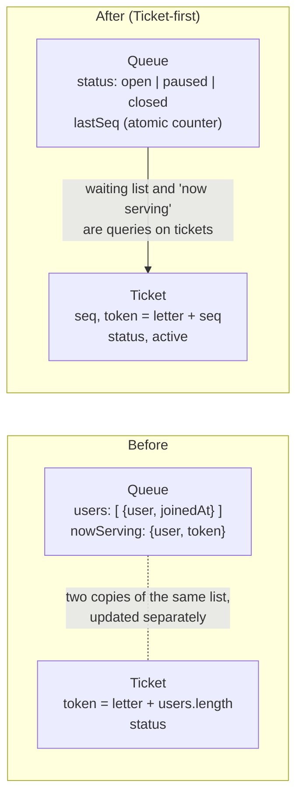

### 3.2 How each guarantee is enforced

| Guarantee | Mechanism |
|---|---|
| Every token in a queue is unique | `lastSeq` is reserved with one atomic `$inc` on join. Unique index on `(queue, seq)`. |
| A user can't hold two places in one queue (double taps) | Unique partial index on `(queue, user)` where `active: true`. The losing request returns the existing ticket (join stays idempotent). |
| Only one person at the counter | Unique partial index on `queue` where `atCounter: true` (called or serving). A concurrent second call-next gets 409 and nobody is skipped. |
| Serve and no-show can't both apply | Both are one `findOneAndUpdate` on the ticket where `atCounter: true` (and its `_id`, which the app sends). The first update takes it off the counter, so the other matches nothing and gets 409. |
| Paused/closed queues reject joins | The `$inc` that reserves a number only matches `status: "open"`. |
| A join racing a close leaves nothing behind | After inserting, join re-reads the status and cancels its own ticket if the queue was closed meanwhile. |
| List and tickets can't disagree | There is no list any more. `users`, `nowServing`, `waitingCount` and `nextToken` in API responses are computed from tickets. |

### 3.3 Queue status

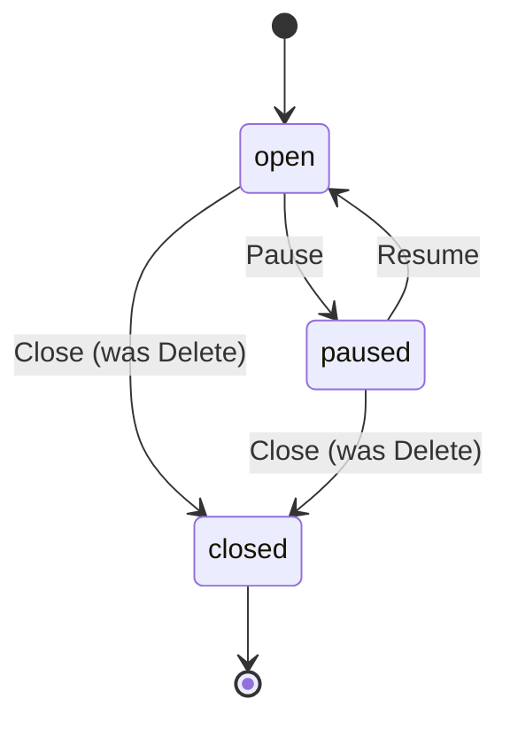

| | open | paused | closed |
|---|---|---|---|
| New joins | yes | 409 `QUEUE_PAUSED` | 409 `QUEUE_CLOSED` |
| Waiting list | kept | kept | waiting tickets cancelled |
| Leave | yes | yes | n/a |
| Call next / serve | yes | yes (work through who is waiting) | call next 409 |
| Listed for users / admin | yes | yes, with its status | no |
| Tickets in admin reports | yes | yes | yes (history is kept) |

Closing also completes the ticket of the person at the counter (`served`),
the same rule call-next uses. A closed queue can't be reopened.

### 3.4 Join (sequence)

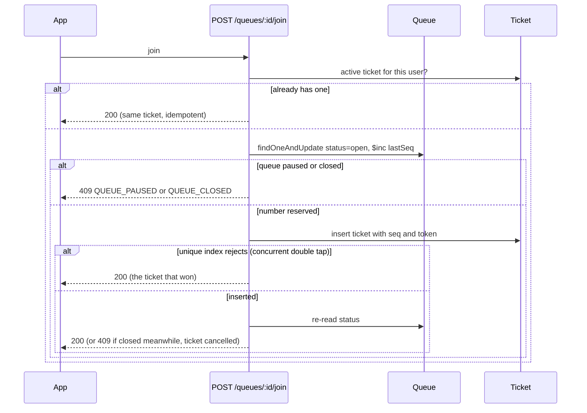

### 3.5 API changes

| Endpoint | Change |
|---|---|
| `PATCH /api/queues/:id/status` | **New.** Body `{ "status": "paused" }` or `{ "status": "open" }`. Owner only. |
| `POST /api/queues/:id/close` | **New.** Closes the queue. Owner only. Returns `{ message, cancelled, servedCurrent }`. |
| `DELETE /api/queues/:id` | Now an alias for close. The queue document and its tickets are kept. |
| `POST /api/queues/:id/join` | 409 when the queue is paused or closed. |
| `POST /api/queues/:id/no-show` | **New.** Owner only. Optional body `{ ticketId }`. 409 if that ticket already left the counter, 400 if nobody is there. |
| `POST /api/queues/:id/serve` | Accepts the same optional `{ ticketId }` (409 if it already left the counter). |
| `PATCH /api/queues/:id/settings` | **New.** Owner only. `{ graceMinutes }` from 1 to 120 (default 5). Also accepted on create. |
| `GET /api/queues/admin/stats` | **New.** Ticket counts per status for the admin's queues, overall and per queue, with `noShow` counted on its own. |
| `GET /api/queues` and queue responses | Add `status`, `graceMinutes`, `waitingCount`, `nextToken`. `nowServing` carries `ticketId`, `status` and `calledAt`. `users` and `nowServing` keep their shape but are computed from tickets. Closed queues are left out. |
| `GET /api/queues/my-status` | Adds `queueStatus`. Positions come from ticket order. |
| Admin reports | Include tickets from closed queues. |

Existing databases are moved to the new model with
`node scripts/migrate_queue_model.js` (dry run) and `--apply`. The migration
never deletes data, numbers existing tickets in join order, and cleans up
leftovers of the old double-join bug.

### 3.6 Ticket states and no-shows

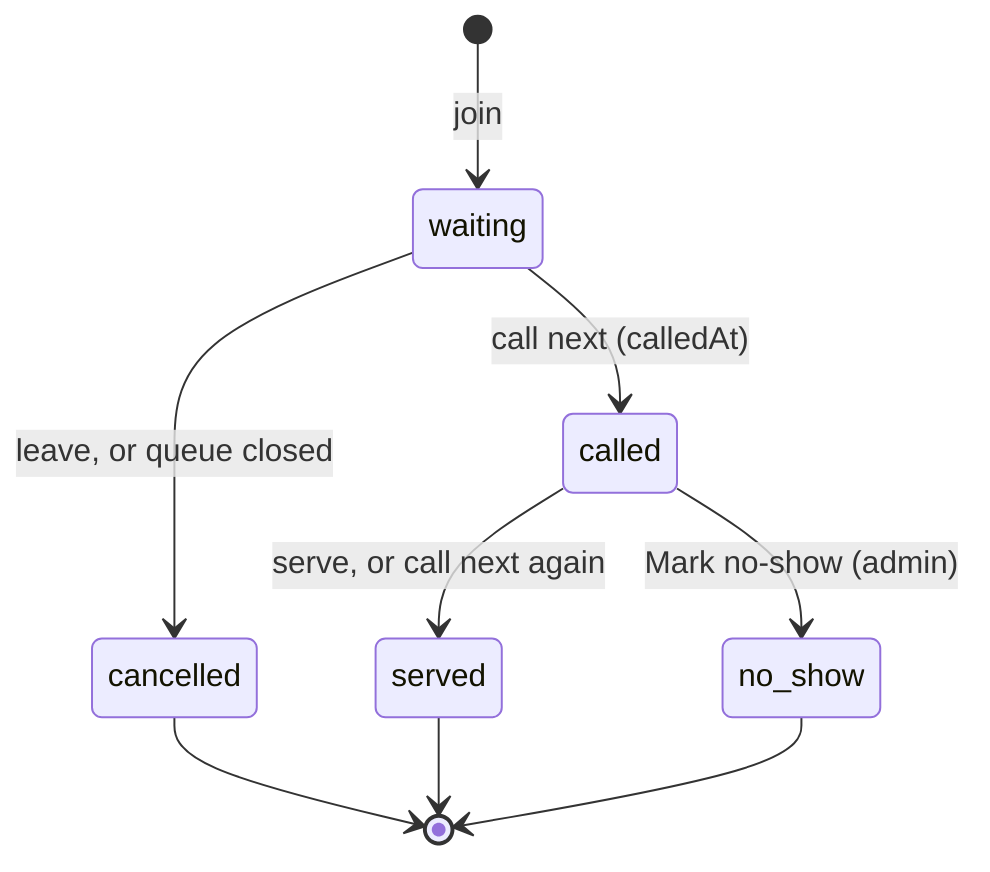

- `called` is what call-next sets. `serving` is the older name for the same
  state, still accepted for tickets created before this change.
- **Mark no-show** is manual and owner-only. The ticket leaves the queue, the
  counter is free, and the admin calls next as usual. A no-show isn't counted
  in `servedToday`. The user sees NO-SHOW in their history and can join again
  with a new ticket.
- **Grace period** (`graceMinutes`, per queue, default 5): once someone has
  been called for longer than this, the admin dashboard shows "overdue" next
  to "Called N min ago". It is only a hint.

**What automatic no-show would take** (not built):

1. **Something that runs on a timer.** The API only acts on requests today.
   Either a sweep with `setInterval` in the server process, or a job queue
   (Agenda, which stores jobs in MongoDB, or BullMQ, which needs Redis) that
   schedules a check at `calledAt + graceMinutes`.
2. **The same atomic update as the manual button**, with
   `calledAt < now - grace` added to the filter. That makes it safe if the
   sweep runs on several server instances or races the admin pressing serve:
   only one update can match.
3. **A policy decision:** after an automatic no-show, should the next person
   be called automatically? If yes, the counter can move on with no staff
   there. Paused queues probably shouldn't auto-expire.
4. **Telling the user before it happens.** A "you're being called" push or
   socket message, and a warning shortly before the grace period ends.
   Otherwise people get marked absent without knowing they were called. The
   "you're being called" part now exists (`ticket:called`, section 4); a
   "grace period ending" warning and push notifications for closed apps
   don't yet.
5. **Tests with a fake clock** (Jest fake timers) for the sweep.

### 3.7 Concurrency numbers (before / after)

Measured with [`backend/bench/concurrency.js`](../backend/bench/concurrency.js)
(`npm run bench:concurrency`). It runs the real Express app against a throwaway
in-memory MongoDB and fires real concurrent HTTP requests. It only uses
endpoints that exist in both versions, so the same script measured both.

Each run is 5 rounds of four scenarios (1,625 requests):

- **burst:** 50 users join one queue at the same moment
- **churn:** 10 waiting, then 15 steps of call-next + join + leave fired together
- **taps:** 20 users each tap Join 5 times at once
- **storm:** 30 users each send join, leave, join, leave at once

| Metric (per 1,625 requests) | Original code (`fcfbb39`) | Before A4 (after error handling, A1) | After A4 |
|---|---|---|---|
| Duplicate tokens | 391 | 883–893 | **0** |
| Double joins (extra active tickets / list entries) | 222 | 851–862 | **0** |
| Waiting list out of sync with tickets | 114 | 125–135 | **0** |
| Unhandled rejections (each would crash the server) | 141 | 0 | **0** |
| Requests that never got a response | 141 | 0 | **0** |
| Requests rejected with 409 (user action lost, retry needed) | 0 | 149–153 | **0** |
| 5xx responses | 0 | 0 | **0** |

"Before A4" and "After A4" are ranges over 3 runs each; "After A4" was 0 in
every run. The original code was run once. It shows fewer duplicates only
because 141 of its requests crashed instead of completing: on a real server
the first unhandled rejection takes the whole process down.

The same guarantees are checked on every test run by
[`backend/tests/concurrency.test.js`](../backend/tests/concurrency.test.js).

---

## 4. Live updates (current)

### 4.1 Before and after

| | Before | After |
|---|---|---|
| Connecting | Anyone could connect, with no login | The JWT goes in the handshake (`auth: { token }`). Invalid, expired or deleted account: refused with `UNAUTHORIZED` |
| Rooms | The client could join any room by name (`joinQueue`), including other people's | The server joins rooms itself, after checking entitlement |
| What was sent | Whole queue documents, including every waiting user's id, broadcast to every client | A small summary with no user ids, sent only to people entitled to that queue |
| Being called | Nothing; users had to keep refreshing | `ticket:called` goes only to the person called, on all their devices |
| App listeners | The admin dashboard added a listener it never removed (one extra refresh per visit) | One listener per screen, removed on unmount |

### 4.2 Rooms

| Room | Who is in it | Joined how |
|---|---|---|
| `user:<id>` | every socket of that user | automatically on connect |
| `admin:<id>` | an admin's sockets | automatically on connect (updates for every queue the admin owns) |
| `users` | all regular users | automatically on connect (queue list changes) |
| `queue:<id>` | watchers of one queue | `queue:subscribe`: admins only for queues they own, users for any queue they can see over REST (not closed) |

### 4.3 Events

| Event | To | Payload |
|---|---|---|
| `queue:update` | `queue:<id>` and the owner's `admin:<id>` | `{ queueId, reason, status, waitingCount, nowServing, nextToken }`, where `nowServing` is just the token |
| `queues:changed` | `users` | `{ queueId, reason }` when a queue is created, paused, resumed or closed |
| `ticket:called` | `user:<id>` of the person called | `{ queueId, queueName, token, calledAt }` |

`reason` is one of `created, joined, left, called, served, no_show, paused,
resumed, settings, closed`. Clients treat an update as "refresh this data"
and re-read it over REST, so the socket never has to carry full documents.

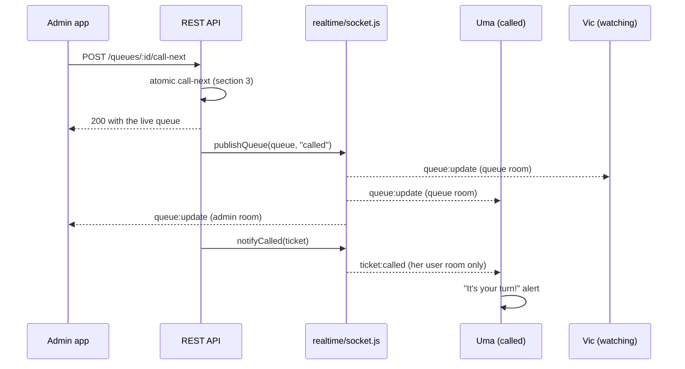

### 4.4 In the app

- [`lib/socket.ts`](../mobile/lib/socket.ts): one shared connection. The
  token is read on every connect, so a new login uses the new token.
- [`lib/auth.tsx`](../mobile/lib/auth.tsx): connects when signed in and
  disconnects on sign-out. Screens never connect themselves.
- [`lib/realtime.ts`](../mobile/lib/realtime.ts):
  - `useSocketEvent` adds one listener and removes it on unmount.
  - `useQueueRooms` subscribes to the queues a screen shows. It keeps a count
    per queue, because the user tabs stay mounted together and one screen
    leaving must not unsubscribe another. It re-subscribes after a reconnect.
  - `useCoalesced` turns a burst of updates into one refresh.
- The user tabs layout shows "It's your turn!" on `ticket:called`, whichever
  tab is open.

### 4.5 Known limits

- The token is checked when a socket connects. A socket that is already
  connected stays connected if its token expires or the account is deleted,
  until it disconnects. REST calls are still checked on every request.
- Allowed browser origins come from `CORS_ORIGINS` and apply to REST and to
  socket handshakes. The handshake check matters because browsers don't apply
  CORS to WebSockets.
- `ticket:called` only reaches an open app. A closed app needs push
  notifications.

---

## 5. Indexes (current)

### 5.1 How this was measured

[`backend/bench/explain.js`](../backend/bench/explain.js)
(`npm run bench:explain -- --md`) seeds a throwaway in-memory MongoDB with
100000 tickets, 200 queues and 5020 users
(20 admins × 10 queues × 500 tickets, 20 waiting per open queue, one queue
per admin closed). It then runs `explain("executionStats")` on each main
query, written exactly as the code issues it, for one admin, one queue and
one user. [`tests/indexes.test.js`](../backend/tests/indexes.test.js) runs the same queries on every
test run and fails on any COLLSCAN, in-memory sort or wasteful read.

"Sort: in memory" means MongoDB had to collect every match and sort it before
returning anything (a blocking SORT stage). Keys and docs examined vs returned
show how much work each query did.

### 5.2 Before

| Query | Code | Plan | Index | Sort | Returned | Keys examined | Docs examined |
|---|---|---|---|---|---|---|---|
| Queue list (admin) | `listQueues` | COLLSCAN | - | - | 9 | 0 | 200 |
| Queue list (user) | `listQueues` | COLLSCAN | - | - | 180 | 0 | 200 |
| Admin's queue ids (reports) | `ownQueueIds / statsReport` | COLLSCAN | - | - | 10 | 0 | 200 |
| Already joined? | `joinQueue` | IXSCAN | `queue_1_user_1` | - | 1 | 1 | 1 |
| Live state of admin's queues | `withLiveState` | IXSCAN | `queue_1_user_1` | in memory | 189 | 190 | 189 |
| Position (people ahead) | `positionOf` | IXSCAN | `queue_1_status_1_seq_1` | - | 19 | 19 | 19 |
| User's waiting ticket | `leaveQueue / userPosition` | IXSCAN | `user_1_status_1` | - | 1 | 1 | 1 |
| My active tickets | `userStatus` | IXSCAN | `user_1_status_1` | in memory | 1 | 22 | 22 |
| My recently finished | `userStatus` | IXSCAN | `user_1_status_1` | in memory | 0 | 22 | 21 |
| My history | `GET /my-history` | IXSCAN | `user_1_status_1` | in memory | 21 | 22 | 21 |
| Ticket at the counter | `finishAtCounter` | IXSCAN | `one_at_counter_per_queue` | - | 1 | 1 | 1 |
| Next to call | `callNext` | IXSCAN | `queue_1_status_1_seq_1` | - | 1 | 1 | 1 |
| Users report | `usersReport` | IXSCAN | `queue_1_status_1_seq_1` | in memory | 5000 | 5001 | 5000 |
| Completed report (top 20) | `completedReport` | IXSCAN | `queue_1_status_1_seq_1` | in memory | 20 | 2902 | 2883 |
| Stats per status | `statsReport` | IXSCAN | `queue_1_status_1_seq_1` | - | 48 | 5000 | 0 |
| Login lookup | `POST /login` | IXSCAN | `email_1` | - | 1 | 1 | 1 |

- 3 COLLSCANs, all on `queues`: it had no index besides `_id`. Since closed
  queues are kept for history (section 3), this collection only grows.
- Ticket queries already used the indexes added for correctness in A4, but 6
  sorted in memory. The completed report examined 2,883 documents to
  return 20, and "my active tickets" examined a user's whole history to find
  one.

### 5.3 After

| Query | Code | Plan | Index | Sort | Returned | Keys examined | Docs examined |
|---|---|---|---|---|---|---|---|
| Queue list (admin) | `listQueues` | IXSCAN | `admin_1_status_1` | - | 9 | 11 | 9 |
| Queue list (user) | `listQueues` | IXSCAN | `status_1` | - | 180 | 181 | 180 |
| Admin's queue ids (reports) | `ownQueueIds / statsReport` | IXSCAN | `admin_1_status_1` | - | 10 | 10 | 10 |
| Already joined? | `joinQueue` | IXSCAN | `queue_1_user_1` | - | 1 | 1 | 1 |
| Live state of admin's queues | `withLiveState` | IXSCAN | `active_by_queue` | - | 189 | 189 | 189 |
| Position (people ahead) | `positionOf` | IXSCAN | `queue_1_status_1_seq_1` | - | 19 | 19 | 19 |
| User's waiting ticket | `leaveQueue / userPosition` | IXSCAN | `queue_1_user_1` | - | 1 | 1 | 1 |
| My active tickets | `userStatus` | IXSCAN | `active_by_user` | - | 1 | 1 | 1 |
| My recently finished | `userStatus` | IXSCAN | `user_1_completedAt_-1` | - | 0 | 0 | 0 |
| My history | `GET /my-history` | IXSCAN | `user_1_createdAt_-1` | - | 21 | 22 | 22 |
| Ticket at the counter | `finishAtCounter` | IXSCAN | `one_at_counter_per_queue` | - | 1 | 1 | 1 |
| Next to call | `callNext` | IXSCAN | `queue_1_status_1_seq_1` | - | 1 | 1 | 1 |
| Users report | `usersReport` | IXSCAN | `queue_1_createdAt_-1` | - | 5000 | 5000 | 5000 |
| Completed report (top 20) | `completedReport` | IXSCAN | `queue_1_status_1_completedAt_-1` | - | 20 | 29 | 20 |
| Stats per status | `statsReport` | IXSCAN | `queue_1_status_1_seq_1` | - | 48 | 5000 | 0 |
| Login lookup | `POST /login` | IXSCAN | `email_1` | - | 1 | 1 | 1 |

- **0 COLLSCANs, 0 in-memory sorts.** Every selective query examines about as
  many documents as it returns. The stats query is answered from index keys
  alone (0 documents).
- Completed report: 2,883 → 20 documents examined. My active tickets: 22 → 1.
  User's waiting ticket: from the user's history (via `user_1_status_1`) to a
  single key.

### 5.4 Indexes added

| Collection | Index | Serves |
|---|---|---|
| queues | `{ admin: 1, status: 1 }` | admin's queue list, report queue ids |
| queues | `{ status: 1 }` | the open queues users can join |
| tickets | `{ queue: 1, seq: 1 }` partial `active: true` (`active_by_queue`) | live state of a dashboard's queues, in ticket order |
| tickets | `{ queue: 1, createdAt: -1 }` | users report, newest first |
| tickets | `{ queue: 1, status: 1, completedAt: -1 }` | completed report (top 20 most recent) |
| tickets | `{ user: 1, createdAt: 1 }` partial `active: true` (`active_by_user`) | my active tickets |
| tickets | `{ user: 1, createdAt: -1 }` | my history |
| tickets | `{ user: 1, completedAt: -1 }` | my recently finished tickets |

`{ user: 1, status: 1 }` was removed: the user indexes above cover its
queries better. Kept from A4: `{ queue: 1, status: 1, seq: 1 }` (waiting
list, position, call next) and the three unique indexes that enforce
correctness (section 3.2).

Two queries were adjusted so an index can answer them. The live-state sort
is now `seq` only (it is unique per queue, so the old `createdAt` tie-breaker
never applied). The waiting-ticket lookups add `active: true` (implied by
`status: "waiting"`), which lets the partial `(queue, user)` index answer.

**Cost:** tickets now have 11 indexes, so each ticket write updates more of
them; the two partial ones only hold active tickets. In this app, reads
dominate: every live update makes each open dashboard re-read its queues.

### 5.5 Applying to an existing database

Mongoose creates missing indexes when the server starts, but never drops
any. To also drop `user_1_status_1`:

```
cd backend
npm run sync:indexes              # dry run: lists creates and drops
npm run sync:indexes -- --apply
```

The dry run lists every index no model declares, including any created by
hand, so check it before applying. Documents are never touched.

---

## 6. Load test (current)

### 6.1 How this was measured

[`backend/bench/load.js`](../backend/bench/load.js) (`npm run bench:load`, about
3 minutes) takes no URL, so it can't be pointed at Render. For each level it
starts its own copy of the real server (`node src/server.js`, a separate
process) against a throwaway MongoDB 8.2 (mongodb-memory-server, WiredTiger,
data in a temp directory). The server runs from a temp directory, so
`backend/.env` is never read.

Each level has 5 queues, one admin each, and N users split evenly across them.
Every user and admin opens a WebSocket with its JWT, as the app does. Users
subscribe to their queue's room, so every change to a queue goes to all
N/5 people watching it.

1. **connect:** all N + 5 sockets connect at the same moment.
2. **burst:** all N users join their queue at the same moment.
3. **position:** all N ask for their position at once. Each queue must read
   exactly 1…k.
4. **churn, 20 s:** each user waits a random think time (mean 5 s), then joins
   if out or leaves if waiting. Each admin loops call-next, 0.5 s, serve,
   0.5 s.

Latency is measured from request sent to response. For sockets:

- **called event:** from sending call-next until the called user's
  `ticket:called` arrives.
- **fan-out:** from sending call-next until each watcher receives that
  queue's `queue:update`.
- **delivered:** the share of watchers that got each update.

Errors are:

- 5xx responses
- requests with no answer in 10 s
- network errors
- socket connect failures and disconnects

400 for an empty queue or counter is an expected answer, not an error.
Afterwards the database is checked for:

- duplicate tokens or sequence numbers in a queue
- users with two active tickets in one queue
- more than one person at a counter

**Setup:** one Apple M3 laptop (8 cores, 8 GB), Node 26. The server, MongoDB
and the load generator all share it, and MongoDB has no network hop. These
numbers describe one Node process on this machine. They do not describe the
deployed service: Render's free instance has 0.1 CPU and reaches Atlas over
the network.

**Is the load generator the bottleneck?** Its own event-loop lag stayed at
p99 ≤ 17 ms through 1,000 users and 88–104 ms at 2,000, so no. A 3,000-user run
is left out because the generator itself lagged there (p99 479 ms), so it
would have measured the client.

**Why the machine was quiet:** a first sweep ran while another program (a
stuck VM) used about 6.6 of the 8 cores. At 1,000 users it gave join p95
1.6 s and burst p95 6.8 s, still with 0 errors. The numbers below come from
two sweeps on the quiet machine (ranges show both runs), plus single runs at
1,500 and 2,000.

### 6.2 Results

**Steady load (20 s of churn).** Times are in milliseconds; p95 except where
noted.

| Users (per queue) | Requests/s | join p50 / p95 | leave | call-next | Live update to every watcher (fan-out) | Delivered | Errors | Server CPU avg | Server memory |
|---|---|---|---|---|---|---|---|---|---|
| 100 (20) | 31–33 | 7 / 19–29 | 20–23 | 18–35 | 18–34 | 100% of 2,000 | 0 | 11% | 140–155 MB |
| 250 (50) | 65 | 6 / 9–14 | 7–9 | 15–16 | 15–16 | 100% of 5,000 | 0 | 15–17% | 186–219 MB |
| 500 (100) | 122–124 | 5 / 9 | 7–8 | 11–14 | 11–13 | 100% of 10,000 | 0 | 31–32% | 281–308 MB |
| **1,000 (200)** | **233–236** | **7 / 22–30** | **19–29** | **19–44** | **18–44** | **100% of 20,000** | **0** | 69–71% | 418–462 MB |
| 1,500 (300) | 304 | 277 / 1,156 | 3,487 | 3,798 | 3,795 | 100% of 17,100 | 0 | 109% | 457 MB |
| 2,000 (400) | 253–258 | 811–822 / 6,296–6,323 | 6,340–6,660 | 2,554–9,804 | 2,551–9,800 | 100% of 6,000 | **2,008–2,261** | 89–91% | 556–571 MB |

The called user's `ticket:called` arrived as fast as the fan-out at every
level, and was never missing. CPU is % of one core. Node runs JavaScript on
one main thread, and above 100% the extra comes from garbage collection and
I/O threads.

**Everyone at once.**

| Users | All join at the same moment: total / p50 / p95 | Positions exactly 1…k | All sockets connect at once: p95 |
|---|---|---|---|
| 100 | 124–128 / 74–78 / 117–121 ms | yes | 40–42 ms |
| 250 | 308–323 / 184–253 / 300–306 ms | yes | 87–90 ms |
| 500 | 810–854 / 569–570 / 778–813 ms | yes | 157–159 ms |
| 1,000 | 2,665–2,745 / 1,729–1,833 / 2,556–2,639 ms | yes | 380–648 ms |
| 1,500 | 6,214 / 3,624 / 5,818 ms | yes | 637 ms |
| 2,000 | 45–111 of 2,000 joins timed out (10 s) | no answer for some | 1,122–1,142 ms |

Every join through 1,500 users returned 200. No socket failed to connect at
any level, and none disconnected.

**Integrity: zero problems in every run, including the overloaded ones.**
Across all levels from 100 to 3,000 users, up to 4,137 tickets per run, there
were:

- 0 duplicate tokens
- 0 duplicate sequence numbers
- 0 users with two active tickets in a queue
- 0 queues with two people at the counter

At 2,000+ the position check fails only because some joins timed out, so not
everyone it expects is in the queue.

### 6.3 Where it degrades, and why

- **Up to 1,000 concurrently active users, it's comfortable.**
  - About 235 requests/s, with each change broadcast to 200 watchers.
  - p95 under 50 ms for join, leave and call-next.
  - Every live update delivered with p95 ≤ 44 ms, and no errors.
- **At 1,500 it degrades but doesn't fail.**
  - Still no errors, and every update is delivered.
  - But p95 rises to 1–4 s, and the server's main thread is saturated (109%).
- **At 2,000 it fails.**
  - Requests time out.
  - About 1,900 connection attempts hit `ETIMEDOUT`, because the server is too busy to accept new connections in time.
- **Simultaneous bursts degrade first.**
  - 1,000 joins in the same instant take 2.7 s in total (p95 2.6 s), with no errors.
  - Two things share the cost:
    1. **Fan-out:** every join is broadcast to everyone watching that queue, so N simultaneous joins into queues of N/5 send N²/5 messages (200,000 at 1,000 users). With room subscriptions turned off (`SUBSCRIBE=0`), the 1,000-user burst p95 drops from 2,545–2,614 ms to 1,289–1,500 ms (2 runs with rooms, 4 without).
    2. **The rest:** the joins themselves, about 640–750 per second. Each one atomically increments its queue's counter, inserts a ticket and reads the live state.

**What would raise the limit (not done):**

- run several Node processes behind the load balancer, with the Socket.io
  Redis adapter and a shared rate-limit store
- coalesce `queue:update` per queue (for example at most one every 100–250 ms)
  so a burst sends one update instead of one per join

### 6.4 Reproducing

```
cd backend
npm run bench:load                           # 100, 250, 500, 1000 users (~3 min)
LEVELS=1500,2000 npm run bench:load          # beyond the comfortable range
SUBSCRIBE=0 LEVELS=1000 npm run bench:load   # burst without socket fan-out
OUT=/tmp/load.json npm run bench:load        # also save the raw numbers
```

Other settings: `QUEUES` (5), `DURATION` (20 s), `THINK_MS` (5000),
`CALL_GAP_MS` (500), `REQUEST_TIMEOUT_MS` (10000). Close heavy programs first:
the server, MongoDB and the load generator share the machine's CPU.

